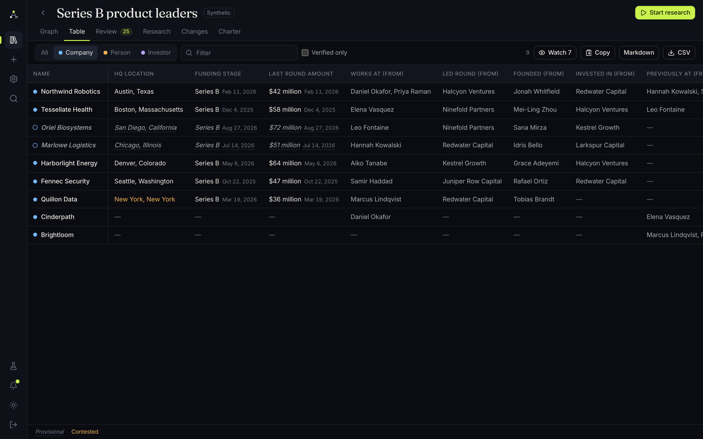
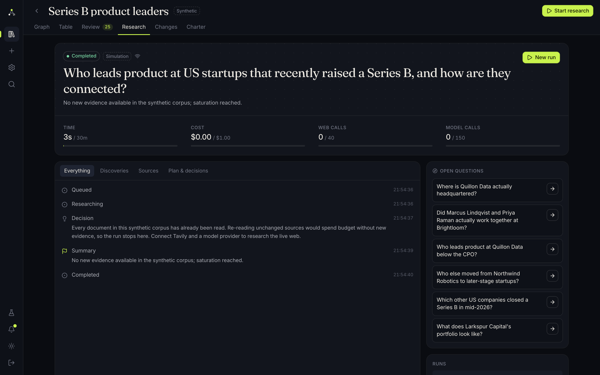
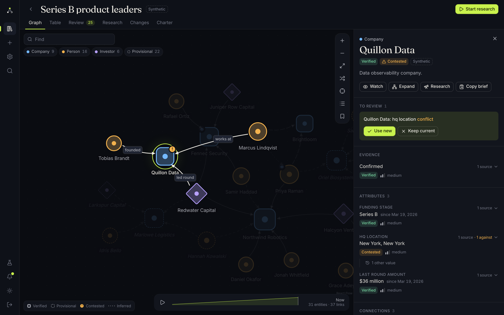
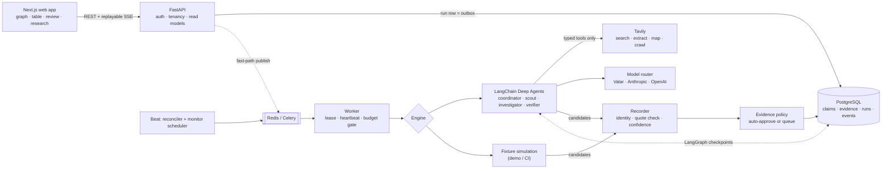

# OpenKG

[](https://github.com/rotemweiss57/open-kg/actions/workflows/ci.yml)

**Tell OpenKG what you want to understand. Research agents investigate the open web, assemble a graph of sourced
claims, show their evidence, and keep watching for changes.**

OpenKG is an open-source, self-hostable platform for long-running research agents that build *evidence-backed*
knowledge graphs. Runs are durable, every fact traces to a quoted source, well-evidenced facts are approved
automatically, and everything else waits for a person.

**Who it is for.** People whose job is to understand companies and markets from public information, and who have
to be able to show where each fact came from: strategy and consulting analysts, investment and corporate
development teams, and B2B sales teams researching named accounts. If that work is done today with a search
engine, a spreadsheet and a lot of copy-paste, OpenKG is built for it.

## What it is best at

| | Account map | Market map | Deal tracker |
| --- | --- | --- | --- |
| **For** | Sales and partnerships | Strategy, consulting and product | Investors and corporate development |
| **You ask** | One company you want to sell to or work with | A category you need to understand | A kind of transaction you need to follow |
| **You get** | Its leadership, where each of them worked before, its investors and its recent launches | The players, where they are based, who funds them and who supplies whom | Who bought or funded whom, for how much and when |
| **Then** | Copy a cited brief into your CRM or call notes | Export the table to a deck or a spreadsheet | Watch the entities so changes come to you |

### Try one

With the app running and keys set ([install](#install-step-by-step)), each link opens a new graph and stops at the
spending confirmation. One more click starts the research.

| Example | Open in the app | Or from the terminal |
| --- | --- | --- |
| **Account map** | [Account map of Stripe](http://localhost:3100/new?quick=1&prompt=Account%20map%20of%20Stripe%3A%20executives%2C%20their%20previous%20companies%2C%20recent%20product%20launches%20and%20main%20investors) | `uv run openkg research "Account map of Stripe: executives, their previous companies, recent product launches and main investors" --confirm-spend` |
| **Market map** | [Map the lab-grown diamond market](http://localhost:3100/new?quick=1&prompt=Map%20the%20lab-grown%20diamond%20market%3A%20producers%2C%20where%20they%20are%20based%2C%20retailers%20they%20supply%20and%20their%20investors) | `uv run openkg research "Map the lab-grown diamond market: producers, where they are based, retailers they supply and their investors" --confirm-spend` |
| **Deal tracker** | [AI company acquisitions announced in 2026](http://localhost:3100/new?quick=1&prompt=AI%20company%20acquisitions%20announced%20in%202026%3A%20the%20acquirer%2C%20the%20target%2C%20the%20price%20and%20the%20date) | `uv run openkg research "AI company acquisitions announced in 2026: the acquirer, the target, the price and the date" --confirm-spend` |

Terminal commands run from `apps/api`. The same three examples are one click away inside the app, on the home screen and under **New graph → Examples**. A capped
run typically costs well under a dollar on the default models. No keys yet? The [quickstart](#quickstart-no-api-keys)
runs the same screens on built-in synthetic data.

## What you can do with it

| | |
| --- | --- |
| **Ask a research question** | Describe it in plain language or start from a playbook (account map, market map, competitive landscape, investor map, leadership map, supply chain). You review the scope, ontology and budget before anything runs. |
| **Watch it build** | Agents plan, search, read and record. Discoveries appear on a live graph as provisional nodes; the area being investigated pulses. Close the tab and the run continues. |
| **Trust what you see** | Click any node or edge for its claims, dates, status and the quoted sources. Verified, provisional, contested and inferred facts look different everywhere. |
| **Review at the speed of evidence** | Facts with enough evidence are approved automatically and logged. The rest are bundled by entity, so one decision can cover a company with its people and investors. |
| **Take the data with you** | A table view with one row per entity and a column per attribute. Copy into Sheets or a CRM, export CSV / JSON / GraphML / Markdown, or copy a cited brief for one entity. A typed REST API backs every view. |
| **Keep it current** | Watch entities, or a whole list from the table. Monitors report only material changes, with before/after evidence. |
| **Go deeper** | **Research** on any entity, or pick from the agent's ranked list of open questions. |

| Table view with evidence | Review, bundled by entity |
| --- | --- |
|  |  |
| **Research in progress** | **Evidence inspector** |
|  |  |

Screenshots show the built-in **synthetic** demo data (fictional companies and people).

## Quickstart (no API keys)

```bash
git clone https://github.com/rotemweiss57/open-kg.git && cd open-kg
docker compose up --build        # or: make demo
# open http://localhost:3100 and click "Enter demo"
```

This starts the web app, API, a Celery worker, the beat scheduler, PostgreSQL and Redis. Demo mode seeds two
synthetic graphs built from fictional `fixture://` documents and labels them as synthetic on every screen. Press
**Start research** to watch a simulated run go through the real pipeline, then review what it found.

A five-minute tour is in [docs/product-demo.md](docs/product-demo.md).

## Install step by step

Without Docker, OpenKG runs on SQLite with the worker inside the API process. You need
[uv](https://docs.astral.sh/uv/) (it installs Python 3.12+ for you) and Node.js 20 or newer.

```bash
git clone https://github.com/rotemweiss57/open-kg.git && cd open-kg
make install
```

`make install` runs five steps and stops with a plain explanation if one fails. It is safe to re-run.

| Step | What happens |
| --- | --- |
| 1. Prerequisites | Checks uv and Node.js. Offers to install uv if it is missing. |
| 2. Dependencies | Installs the API and web app dependencies. |
| 3. **API keys** | Asks for a Tavily key and one model provider key (Valar, Anthropic or OpenAI). Input is hidden, each key is checked with a free call, and a typo can be retried. Press Enter to skip and use demo mode. |
| 4. Verify | Runs `openkg doctor`, a checklist of everything the app needs. |
| 5. Done | Prints the command to start. |

```bash
make dev          # API on :8100, web app on :3100  →  open http://localhost:3100
```

Later, any time:

```bash
make setup              # add or change keys, switch provider, change the per-run spending limit
make doctor ONLINE=1    # re-check everything, including whether the keys still work (free calls)
make help               # every command
```

Other ways to run the installer: `./scripts/install.sh --demo` (no key prompts), `--yes` (no prompts; reads
`TAVILY_API_KEY` and a provider key from the environment), `--docker` (configure only, then
`docker compose up --build`).

## Install with a coding agent

OpenKG ships an [AGENTS.md](AGENTS.md) written for coding agents: exact commands, the output to expect after
each one, and what to do when it differs. Paste this into Claude Code, Cursor, Codex or a similar agent:

```text
Install and start OpenKG from https://github.com/rotemweiss57/open-kg.
Clone it, then follow AGENTS.md in the repository root step by step.
Stop and ask me when you reach the API keys step; never print or commit a key.
When it is running, tell me the URL and how to start my first research run.
```

Agents are told to never echo keys, to hand the key prompt to you (`make setup`, hidden input) or use keys
already in the environment, and to never start a paid run without your go-ahead.

## Live research setup

Live research needs a web-research key and one model provider key. `make setup` asks for them, checks them and
writes `.env` for you. To do it by hand instead, copy `.env.example` to `.env`, fill in the keys, and restart.

| You need | Get it here | Set |
| --- | --- | --- |
| **Tavily** for search, extract, map and crawl | [app.tavily.com](https://app.tavily.com) · [docs](https://docs.tavily.com) | `TAVILY_API_KEY` |
| **One model provider**: Valar, Anthropic or OpenAI | Valar: [quickstart](https://docs.valarhq.ai/quickstart) · [models](https://docs.valarhq.ai/) | `VALAR_API_KEY`, or `ANTHROPIC_API_KEY`, or `OPENAI_API_KEY` |
| *Optional:* run tracing in LangSmith | [LangSmith](https://smith.langchain.com) | `LANGSMITH_API_KEY`, `LANGSMITH_TRACING=true` (LangChain's standard variables; not exercised by our tests) |

```bash
make setup                # guided: keys, provider, spending limit
make doctor ONLINE=1      # confirms the keys work; never prints them
```

Every live run asks you to confirm hard limits (cost, web calls, model calls, deadline) that the server enforces.
With the default models on Valar, a capped run typically costs well under a dollar.

## Research from the terminal

```bash
cd apps/api
uv run openkg research "Which companies build vector databases, and who funds them?" \
  --confirm-spend --max-usd 1 --max-web-calls 30 --export markdown --out vector-dbs.md
```

The command starts one capped run, prints progress as it works, lists every finding with its confidence, and
writes a cited report. `--export` also takes `json`, `csv` or `graphml`. The graph appears in the web app too,
where you can review it. Ctrl-C cancels cleanly and keeps what was found. `--confirm-spend` is required because
this spends real credits.

## How it works



**The long-running agent, in one paragraph.** Starting a run commits a row and returns its ID. A worker must win a
time-boxed lease on that row and heartbeats while it works. The engine is a LangChain **Deep Agents** coordinator
that plans coverage and delegates to three subagents: a discovery scout, an entity investigator and an evidence
verifier. Agents act only through typed tools: **Tavily** for the web, and `record_candidate_*` for output. They
have no shell, SQL or arbitrary HTTP. Each tool call checks for cancellation and budget first. Candidates pass
through a deterministic recorder that resolves identity, verifies that each quote occurs in the retrieved page,
and derives confidence from independent sources. If a worker dies, its lease expires, a reconciler re-dispatches
the run, and LangGraph's checkpointer resumes the agent; idempotency keys make replays harmless.

More detail: [docs/architecture.md](docs/architecture.md) · [docs/security.md](docs/security.md).

## Trust rules

- A web page is evidence, not an entity. A suggestion is not a fact.
- **Quotes are checked.** Every fact carries a quote, and the quote must appear on the retrieved page word for
  word. Formatting and punctuation are ignored and "..." may skip text, but a paraphrase fails. A fact whose
  quote is not found is held at low confidence, and the agent is told so it can re-quote or drop it.
- **The page must be about the subject.** Evidence from a page that never names the entity it is filed under is
  discarded. This catches the commonest model mistake: one person's degree filed under a colleague.
- **Confidence is computed, not asserted.** *High* needs two independent sources. Two copies of one press release
  count once. The model can lower confidence but not raise it.
- **Approve on evidence** (the default for new graphs). A low-risk addition is approved automatically, and logged,
  when it has two independent verified sources, or when an organisation states a fact about itself on its own
  site. Single-source third-party facts, changes, conflicts, merges and inferred links always wait for a person.
- **One node per real thing.** A company is one node whatever a model calls its type (Company, Investor) or
  context. People are never merged on name alone: namesakes become a "possible duplicate" for review.
- **Time is first class.** Facts carry **valid time** (when true in the world) and **observed time** (when
  research found it). A newer dated value supersedes the old one, which is kept as history: Series F in 2025 and
  Series G in 2026 are a timeline, not a conflict.
- **A conflict means a real disagreement.** Undated, incompatible values for a single-valued attribute mark the
  claim **contested**. The same fact in other words does not: "Berlin" and "Berlin, Germany", "CEO" and
  "CEO & Co-Founder", "2012" and "2012-02-09", `founding_year` and `founded_year`. Neither do attributes that hold
  several values, such as products, offices or degrees.
- Rejected suggestions are kept for audit and are not proposed again.

## Choosing models

Research is not latency-sensitive, so OpenKG assigns a model per role for accuracy and cost rather than speed.

| Role | Default on Valar | What it does |
| --- | --- | --- |
| Coordinator | `Qwen/Qwen3.5-397B-A17B` | Plans coverage and delegates |
| Discovery scout | `openai/gpt-oss-120b` | High-volume search and first-pass recording |
| Entity investigator | `Qwen/Qwen3.5-397B-A17B` | Reads pages and records cited, dated facts |
| Evidence verifier | `Qwen/Qwen3.5-397B-A17B` | Looks for independent second sources |

Override any role with `MODEL_ROLE_PLANNER`, `MODEL_ROLE_RESEARCHER`, `MODEL_ROLE_EXTRACTOR` or
`MODEL_ROLE_VERIFIER` (`provider:model`). Anthropic and OpenAI have their own defaults in
`apps/api/openkg/agent/models.py`. To compare models on your own material, run
`apps/api/scripts/model_bench.py`.

## Built on

OpenKG stands on three projects that made it practical to build.

**[LangChain](https://www.langchain.com) — Deep Agents and LangGraph.** The research loop is a
[Deep Agents](https://docs.langchain.com/oss/python/deepagents/overview) coordinator with subagents. Deep Agents
gave us planning, context management and delegation out of the box, with a middleware system clean enough that
adding steering, budget gates and metering took a few dozen lines. [LangGraph](https://docs.langchain.com/oss/python/langgraph/add-memory)
checkpointing is what lets a run survive a dead worker and pick up where it stopped. If you want to build your own
long-horizon agent, start with the [Deep Agents overview](https://docs.langchain.com/oss/python/deepagents/overview).

**[Valar](https://docs.valarhq.ai/) — inference.** Valar's OpenAI-compatible API gave us one endpoint for two dozen
open models with published per-model prices, which is what made per-role model selection and honest cost
estimates possible. Its Responses API streamed tool calls reliably through hundreds of agent steps, and its clear
[compatibility notes](https://docs.valarhq.ai/compatibility) told us exactly how to run an agent loop statelessly.
With the measured defaults above, our research runs came in under a dollar. Get a key from the
[Valar quickstart](https://docs.valarhq.ai/quickstart).

**[Tavily](https://www.tavily.com) — web research.** Search, extract, map and crawl through one API built for
agents, with relevance-ranked snippets that are often enough to record a cited fact without fetching the page.

Also: FastAPI, SQLAlchemy, Celery, Next.js, React Flow, TanStack Query, Radix UI and Tailwind CSS.

## Contributing

See [CONTRIBUTING.md](CONTRIBUTING.md). Security reports: [SECURITY.md](SECURITY.md).

## License

Apache-2.0. See [LICENSE](LICENSE).
