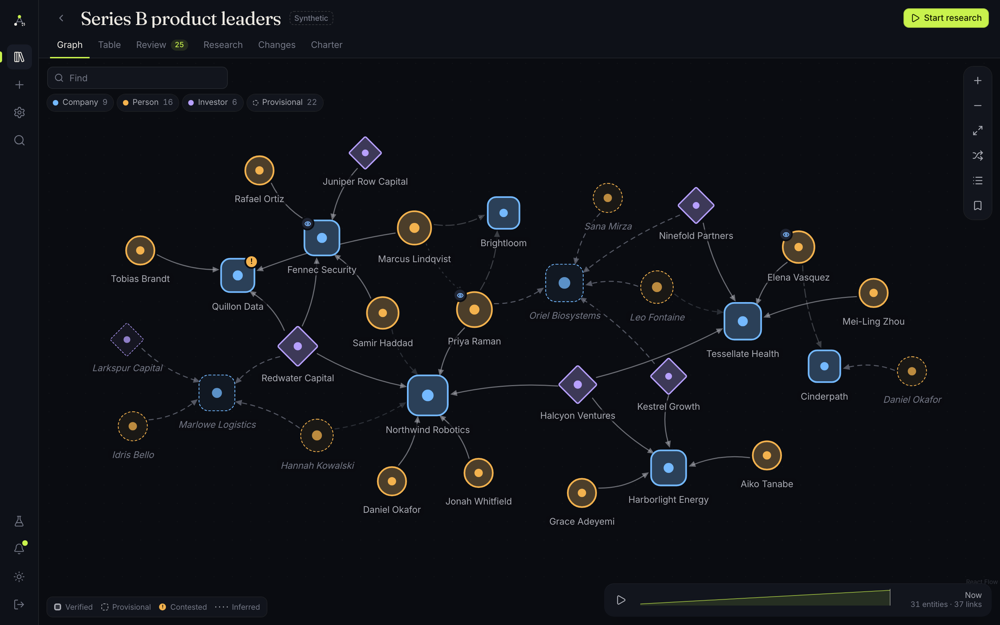
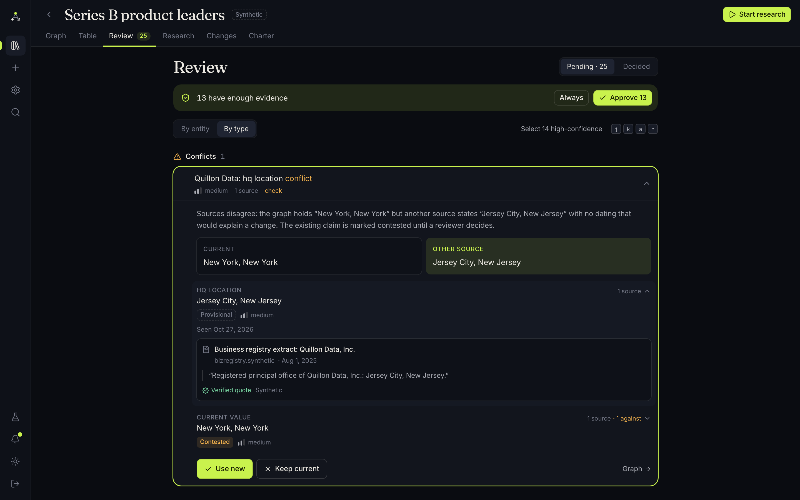
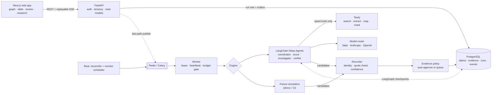

# OpenKG

[](https://github.com/rotemweiss57/open-kg/actions/workflows/ci.yml)
[](LICENSE)

**Tell OpenKG what you want to understand. Research agents investigate the open web, build a graph of cited
facts, and keep watching for changes.**

OpenKG is an open-source, self-hosted platform for long-running research agents. Every fact in the graph opens
to the quote and page it came from. Well-evidenced facts are approved automatically; everything else waits for you.



## Who it is for

People whose job is to understand companies and markets from public information, and who have to show where
each fact came from: strategy and consulting analysts, investment and corporate development teams, and B2B sales
teams researching named accounts. If that work happens today in a search engine, a spreadsheet and a lot of
copy-paste, OpenKG is built for it.

## What it is best at

| | Account map | Market map | Deal tracker |
| --- | --- | --- | --- |
| **For** | Sales and partnerships | Strategy, consulting and product | Investors and corporate development |
| **You ask about** | One company you want to sell to or work with | A category you need to understand | A kind of transaction you need to follow |
| **You get** | Its leadership, where each of them worked before, its investors and recent launches | The players, where they are based, who funds them and who supplies whom | Who bought or funded whom, for how much and when |
| **Then** | Copy a cited brief into your CRM or call notes | Export the table to a deck or spreadsheet | Watch the entities so changes come to you |
| **Try it** | [Stripe](http://localhost:3100/new?quick=1&prompt=Account%20map%20of%20Stripe%3A%20executives%2C%20their%20previous%20companies%2C%20recent%20product%20launches%20and%20main%20investors) | [Lab-grown diamonds](http://localhost:3100/new?quick=1&prompt=Map%20the%20lab-grown%20diamond%20market%3A%20producers%2C%20where%20they%20are%20based%2C%20retailers%20they%20supply%20and%20their%20investors) | [AI acquisitions in 2026](http://localhost:3100/new?quick=1&prompt=AI%20company%20acquisitions%20announced%20in%202026%3A%20the%20acquirer%2C%20the%20target%2C%20the%20price%20and%20the%20date) |

The **Try it** links open a running OpenKG with the question filled in and stop at the spending confirmation; one
more click starts the research. The same three examples are on the app's home screen. A capped run typically costs
well under a dollar.

## Get started

**Try the demo (no keys).** Synthetic data and simulated runs on the real pipeline:

```bash
git clone https://github.com/rotemweiss57/open-kg.git && cd open-kg
docker compose up --build          # then open http://localhost:3100 and click "Enter demo"
```

**Install for live research.** You need [uv](https://docs.astral.sh/uv/) and Node.js 20 or newer:

```bash
git clone https://github.com/rotemweiss57/open-kg.git && cd open-kg
make install      # checks prerequisites, installs, asks for your API keys, verifies
make dev          # http://localhost:3100
```

`make install` asks for two keys, checks each with a free call, and writes them to a private `.env`:

| Key | Get it | Variable |
| --- | --- | --- |
| **Tavily**, for web search and reading | [app.tavily.com](https://app.tavily.com) | `TAVILY_API_KEY` |
| **One model provider**: Valar, Anthropic or OpenAI | [Valar quickstart](https://docs.valarhq.ai/quickstart) · [Anthropic](https://console.anthropic.com/settings/keys) · [OpenAI](https://platform.openai.com/api-keys) | `VALAR_API_KEY`, `ANTHROPIC_API_KEY` or `OPENAI_API_KEY` |

Later: `make setup` changes keys or the spending limit, `make doctor ONLINE=1` checks everything including the
keys, and `make help` lists every command. Every live run has hard caps on cost, web calls, model calls and time
that the server enforces.

<details>
<summary><b>Install with a coding agent</b></summary>

[AGENTS.md](AGENTS.md) is written for coding agents: exact commands, the output to expect, and what to do when it
differs. Paste this into Claude Code, Cursor, Codex or similar:

```text
Install and start OpenKG from https://github.com/rotemweiss57/open-kg.
Clone it, then follow AGENTS.md in the repository root step by step.
Stop and ask me when you reach the API keys step; never print or commit a key.
When it is running, tell me the URL and how to start my first research run.
```

</details>

<details>
<summary><b>Research from the terminal</b></summary>

```bash
cd apps/api
uv run openkg research "Account map of Stripe: executives, their previous companies, recent product launches and main investors" \
  --confirm-spend --max-usd 1 --export markdown --out stripe.md
```

One capped run with live progress, every finding with its confidence, and a cited report (`markdown`, `json`,
`csv` or `graphml`). The graph also appears in the web app. Ctrl-C cancels cleanly and keeps what was found.

</details>

<details>
<summary><b>Other install options</b></summary>

- `./scripts/install.sh --demo` installs without asking for keys.
- `./scripts/install.sh --yes` takes `TAVILY_API_KEY` and a provider key from the environment, with no prompts.
- `./scripts/install.sh --docker` checks Docker and configures keys for `docker compose up --build`, which runs the
  web app, API, a Celery worker, the scheduler, PostgreSQL and Redis.
- To configure by hand, copy `.env.example` to `.env`.
- Optional tracing: set LangChain's standard `LANGSMITH_API_KEY` and `LANGSMITH_TRACING=true`.

</details>

## What you can do

| | |
| --- | --- |
| **Ask** | Describe a question in plain language, or start from an example or template. You can edit the scope, the ontology and the budget before anything runs. |
| **Watch** | Agents plan, search, read and record. Discoveries appear on a live graph as provisional nodes. Close the tab and the run continues. |
| **Check** | Click any node or edge for its facts, dates and quoted sources. Verified, provisional and contested facts look different everywhere. |
| **Review** | Facts with enough evidence are approved automatically and logged. The rest are grouped by entity, so one decision covers a company with its people and investors. |
| **Use** | A table with one row per entity. Copy into Sheets or a CRM, export a cited report, CSV, JSON or GraphML, or call the typed REST API. |
| **Follow** | Watch any entity. A check reports only what changed, with the before and after evidence side by side. |
| **Go deeper** | Run focused research on one entity, or pick from the agent's list of open questions. |

| Table | Review |
| --- | --- |
|  |  |
| **Research in progress** | **Evidence** |
|  |  |

Screenshots show the built-in synthetic demo data (fictional companies and people). A five-minute tour is in
[docs/product-demo.md](docs/product-demo.md).

## Why you can trust the graph

- **Every fact has a checked quote.** The quote must appear on the retrieved page word for word. A paraphrase
  fails, and a fact whose quote is not found is held at low confidence.
- **The page must be about the subject.** Evidence from a page that never names the entity is discarded.
- **Confidence is computed, not asserted.** High confidence needs two independent sources; two copies of one press
  release count once. A model can lower confidence but never raise it.
- **Approval follows evidence.** A new fact is approved automatically only with two independent sources, or when an
  organisation says it about itself on its own site. Changes, conflicts and merges always wait for a person.
- **Time is part of every fact.** A newer dated value replaces the old one and keeps it as history, so Series F in
  2025 and Series G in 2026 are a timeline, not a conflict.
- **One node per real thing.** A company is one node whatever a model calls it. People are never merged on name
  alone; namesakes are offered as a possible duplicate.
- **Nothing is lost.** Rejected suggestions and every decision stay in the audit history.

## How it works



**The long-running agent, in one paragraph.** Starting a run commits a row and returns its ID. A worker must win a
time-boxed lease on that row and heartbeats while it works. The engine is a LangChain **Deep Agents** coordinator
that plans coverage and delegates to three subagents: a discovery scout, an entity investigator and an evidence
verifier. Agents act only through typed tools: **Tavily** for the web, and `record_candidate_*` for output. They
have no shell, SQL or arbitrary HTTP. Each tool call checks for cancellation and budget first. Candidates pass
through a deterministic recorder that resolves identity, verifies that each quote occurs in the retrieved page,
and derives confidence from independent sources. If a worker dies, its lease expires, a reconciler re-dispatches
the run, and LangGraph's checkpointer resumes the agent; idempotency keys make replays harmless.

More detail: [docs/architecture.md](docs/architecture.md) · [docs/security.md](docs/security.md).

## Models

Research is not latency-sensitive, so each role gets a model chosen for accuracy and cost rather than speed.

| Role | Default on Valar | What it does |
| --- | --- | --- |
| Coordinator | `Qwen/Qwen3.5-397B-A17B` | Plans coverage and delegates |
| Scout | `openai/gpt-oss-120b` | High-volume search and first-pass recording |
| Investigator | `Qwen/Qwen3.5-397B-A17B` | Reads pages and records cited, dated facts |
| Verifier | `Qwen/Qwen3.5-397B-A17B` | Looks for independent second sources |

Override any role with `MODEL_ROLE_PLANNER`, `MODEL_ROLE_RESEARCHER`, `MODEL_ROLE_EXTRACTOR` or
`MODEL_ROLE_VERIFIER` (`provider:model`). Anthropic and OpenAI have their own defaults in
`apps/api/openkg/agent/models.py`. To compare models on your own material, run `apps/api/scripts/model_bench.py`.

## Built on

OpenKG stands on three projects that made it practical to build.

**[LangChain](https://www.langchain.com) — Deep Agents and LangGraph.** The research loop is a
[Deep Agents](https://docs.langchain.com/oss/python/deepagents/overview) coordinator with subagents. Deep Agents
gave us planning, context management and delegation out of the box, with a middleware system clean enough that
adding steering, budget gates and metering took a few dozen lines. [LangGraph](https://docs.langchain.com/oss/python/langgraph/add-memory)
checkpointing is what lets a run survive a dead worker and pick up where it stopped. If you want to build your own
long-horizon agent, start with the [Deep Agents overview](https://docs.langchain.com/oss/python/deepagents/overview).

**[Valar](https://docs.valarhq.ai/) — inference.** Valar's OpenAI-compatible API gave us one endpoint for two dozen
open models with published per-model prices, which is what made per-role model selection and honest cost
estimates possible. Its Responses API streamed tool calls reliably through hundreds of agent steps, and its clear
[compatibility notes](https://docs.valarhq.ai/compatibility) told us exactly how to run an agent loop statelessly.
Get a key from the
[Valar quickstart](https://docs.valarhq.ai/quickstart).

**[Tavily](https://www.tavily.com) — web research.** Search, extract, map and crawl through one API built for
agents, with relevance-ranked snippets that are often enough to record a cited fact without fetching the page.

Also: FastAPI, SQLAlchemy, Celery, Next.js, React Flow, TanStack Query, Radix UI and Tailwind CSS.

## Contributing

See [CONTRIBUTING.md](CONTRIBUTING.md). Security reports: [SECURITY.md](SECURITY.md).

## License

Apache-2.0. See [LICENSE](LICENSE).
